# Super Simple Software Factory

> **Repeatable agents-plus-code workflows, packaged as one skill, stamped into any repo.**
> Deterministic Python owns the graph. Coding agents are bounded nodes inside it.

📺 Full breakdown on YouTube: **[Super Simple Software Factory](https://youtu.be/haUfb1ievTE)**

<p align="center">
  
</p>

<p align="center">
  
</p>

A software factory does one thing: it gives you more leverage on your prompt. How much leverage depends entirely on what you invest in it. At the low end you chain two agents together and hope. At the high end you build a system of agents plus code that runs without you, and does the job about as well as you would.

Everyone can get an agent to write code once. Almost nobody gets the same result twice. This fixes that by moving the control plane out of the prompt and into Python. An ADW script (AI Developer Workflow) owns sequencing, retries, and acceptance. Agents work inside named phases. Typed JSON envelopes carry context across the seams. Every event streams into SQLite while it is still happening. **Agent proposes, code disposes.**

> [!NOTE]
> **This branch is the skill alone**, which is the thing you install. For a repo with the factory already stamped into it, a demo app it planned, built, tested, reviewed, and documented, and the real traces from those runs, see the **[`example` branch](../../tree/example)**.

---

## Why this exists

<p align="center">
  
</p>

Hand a capable model your whole SDLC and you get a machine with no seams. There is no phase boundary, so you cannot say which step failed. There is no acceptance criterion you can name, so "done" means "the agent stopped talking." A retry is a cold start that throws away everything the agent just learned. The only trace is a transcript you have to read like a novel. Run it twice, get two different systems.

The fix is not a better prompt. The fix is deciding, deliberately, that **code owns sequencing, retries, and acceptance, and the agent owns only the work inside one bounded phase**. Everything else falls out of that one line. Phases become the unit of the trace. Envelopes become the only way context crosses a seam. Gates become the definition of done. A correction becomes cheaper than a restart, because the session is still alive.

### Agents are great. You do not always need one.

This is the part most engineers are going to skip, and pay for later.

Code costs nothing. It runs at the speed of light. You can change it in a second. And you actually own it, which is not true of any model you are renting by the token.

So when the invocation is already known, write it down. `bun test` is not a judgement call. Neither is `ruff check`. An agent rediscovering your test runner burns a context window to learn what a subprocess already knows, and it charges you for the privilege every single run. Worse, it puts a passing test suite into a context window, which buys you nothing at all.

Agents are for the parts that need reading and deciding. Everything else is a `kind="code"` phase. When code fails, the failure comes back to the builder as an envelope, through the same door an agent's report would have used. The repair loop is identical. You just stopped paying an agent to do arithmetic.

The bill for skipping this is not only tokens. It is cost, speed, and consistency, and you pay it on run one hundred and run one thousand, not on run one.

> *Same models. Same prompts. The difference is who owns the loop.*

---

## Install

Two steps: get the skill into your repo, then stamp the factory.

### Agentic Install

Copy `.claude/skills/sssf/` into the target repo and type `/sssf install` inside Claude Code. The skill is named `sssf`, so that is the skill name followed by the `install` argument. There is no bare `/install` command. The agent reads the skill's own `cookbooks/install.md` and does the rest.

### Manual Install

**Prereqs:** [`uv`](https://docs.astral.sh/uv/), [Claude Code](https://claude.com/claude-code) (the `claude` CLI) signed in to your Claude subscription, and `git`. On Linux, [`bubblewrap`](https://github.com/containers/bubblewrap) (`apt install bubblewrap`) so agents run sandboxed; without it they run unsandboxed with a loud warning. [`bun`](https://bun.sh) only if you want the visualizer. No API keys and no `sqlite3` CLI: see below.

```bash
# 1. get the skill into the target repo
mkdir -p .claude/skills
cp -r /path/to/super-simple-software-factory/.claude/skills/sssf .claude/skills/

# 2. stamp the factory (run from the target repo ROOT, the cwd is where everything lands)
uv run .claude/skills/sssf/scripts/install.py
claude auth status                               # confirm you are signed in to your subscription
cp .env.sample .env                              # optional: nothing in it is required
git add -A && git commit -m "stamp sssf"         # every run branches from a commit: it needs one

# 3. set your real test command: adws/adw_modules/quality.py, test_spec()
#    install.py prints the one it detected. Until you set it, ADWs with a test phase refuse to start.

# 4. smoke test: two cheap read-only runs, end to end
just demo
just sessions              # what just happened
just obs                   # the trace UI, needs bun

# no just? every recipe is one line. the raw form of `just demo` is:
uv run adws/adw_prompt.py "reply with a one-line summary of this repo" --agent scout
```

Re-running `install.py` is safe. It skips every file that already exists and reports what it skipped, so a second run doubles as a drift check. `--force` refreshes stamped code to the skill's current version, but it overwrites **all** stamped files including your `sssf.config.yaml` and your prompts, so commit first.

Green on the smoke test means the whole path works: config validated, session minted, Claude Code ran, envelope parsed, events landed in `adws/adw_data/sssf.db`. Fix it there before composing anything larger, because every multi-agent chain rides this exact path.

### Authentication: your Claude subscription, not API keys

Every agent runs through the `claude` CLI, so the whole factory bills against the Claude subscription you are already signed in with (`claude auth login`). There is no provider key to set. On a headless box, `claude setup-token` prints a token you export as `CLAUDE_CODE_OAUTH_TOKEN`.

**Do not set `ANTHROPIC_API_KEY`.** Claude Code prefers an API key over the subscription login, so a key left in your shell or `.env` would turn every agent call into metered API billing. SSSF removes `ANTHROPIC_API_KEY` and `ANTHROPIC_AUTH_TOKEN` from the environment it hands to `claude`. If you do want API billing, set `SSSF_ALLOW_API_KEY=1`.

Two consequences of running on a subscription:

- **Usage limits, not dollars.** You draw on a rolling five-hour window plus weekly caps, and Opus drains them several times faster than Sonnet or Haiku. When the window runs out mid-phase, the run **waits for the reset and resumes the same agent session** (the stream reports the reset time), up to `rate_limit_max_wait_seconds` (6 h by default). The `cost` the trace shows is the list-price *equivalent* of the tokens used, useful for comparing runs and for the per-run budget, not a charge. On a **Pro** plan, consider `sonnet` for the planner and reviewer: one Opus-heavy run can use most of a window.
- **Models are Claude models.** `model:` is an alias (`fable`, `opus`, `sonnet`, `haiku`, each resolving to the newest in its family) or a full id such as `claude-sonnet-5-5`. Claude Code has no model-listing command, so `agents.validate()` checks that the value *looks* like a Claude model and the first call proves it exists. A well-formed id that does not exist fails that agent's call with the CLI's own error. Pin a full id when you need a run to be repeatable, because an alias moves when a newer model ships.


---

## Three principles

Everything here is built to be **observable**, **customizable**, and **reusable**. Those are not adjectives, they are the reason the parts are shaped the way they are.

**Observable.** If you cannot measure your agents, you cannot improve them. Every event goes into SQLite as it happens, so you can watch a run mid-flight, not read about it afterwards.

**Customizable.** One YAML file sets the core four for every agent: context, model, prompt, tools. Different models at different price and speed points, in the same run. It is not about which model is best anymore, it is about which model is right for that one phase.

**Reusable.** The whole thing is a skill you stamp into any repo, then bend to fit. The tests it ships are not your tests. The prompts it ships are starters. It is designed to be edited.

There are three actors here, and the design keeps them separate on purpose: **the engineer**, **the code**, and **the agents**. The trick is not running more agents. The trick is using all three at the right moment.

---

## The skill is the product

<p align="center">
  
</p>

Everything lives in `.claude/skills/sssf/`. `SKILL.md` carries the hard rules and routes each request to one of nine cookbooks. `references/` holds the deep specs, `scripts/` holds the generators, `templates/` holds exactly what gets stamped.

| What lands in your repo | Where it comes from | Tracked |
|---|---|---|
| `adws/adw_sssf_config/sssf.config.yaml` | `templates/sssf.config.yaml` | yes, it is your agent roster |
| `adws/adw_*.py` | `templates/adws/` | yes, twelve starter workflows |
| `adws/adw_modules/` | `templates/adws/adw_modules/` | yes, all low-level logic |
| `adws/adw_data/prompt_engineering/` | `templates/prompt_engineering/` | yes, **your prompts live here** |
| `adws/adw_data/harness_engineering/` | `templates/harness_engineering/` | yes, MCP config files for an agent |
| `.env.sample` | `templates/env.sample` | yes |
| `justfile` | `templates/justfile` | yes, starter recipes to run and watch |
| `adws/adw_data/sessions/`, `sssf.db` | created at runtime | no, gitignored |

The prompts are yours the moment they land. Edit them in `adws/adw_data/prompt_engineering/{agent}/`, never back inside the skill.

There is no DSL here. No framework to learn. It is Python, YAML, agents, and a skill, which is exactly what these models are already trained on. Staying in distribution is a feature.

---

## The agent roster

`adws/adw_sssf_config/sssf.config.yaml` answers one question per entry: who is this agent. One agent, one prompt, one purpose.

```yaml
defaults:
  coding_agent: claude_code        # every agent runs through the claude CLI on your subscription
  model: sonnet                    # fable | opus | sonnet | haiku, or a full id like claude-sonnet-5-5
  effort: medium                   # low | medium | high | xhigh | max
  protected_files:                 # no agent may edit the machinery that grades it
    - adws/adw_modules/
    - adws/adw_sssf_config/
    - adws/adw_*.py
    - .claude/
    - .github/
    - .env
  grader_files:                    # existing tests + test config: locked unless the plan declares them
    - "**/tests/**"
    - "**/test_*.py"
    - "**/package.json"            # ...and the rest of the list in the stamped config
  data_dir: adws/adw_data
  sandbox: {enabled: true}         # bubblewrap around every agent and every test run
  max_run_cost_usd: 25             # per-run ceiling, list-price equivalent

agents:
  - name: planner
    model: opus
    effort: high                   # per-agent overrides win over defaults
    color: "#a78bfa"               # this agent's lane swatch in the trace
    purpose: Turn a request into a plan the builder can implement without asking questions.
    prompt_engineering:
      system: adws/adw_data/prompt_engineering/planner/system.md
      user: adws/adw_data/prompt_engineering/planner/user.md
    tools: [Read, Grep, Glob, Bash, Write, Agent]   # Agent = Claude Code subagents
    writes:                        # the plan is all it may leave in the repo
      - specs/
```

Five starter agents ship in the box: `planner`, `builder`, `scout` (read-only recon), `reviewer`, and `documenter`. There is no tester, because running a suite is a known command and therefore code.

Every agent gets its own model, effort level, prompts, tools, and harness. That is the core four, and it is the whole surface you tune. Give the planner Opus and the builder Sonnet. Give the scout the `Agent` tool so it can fan out subagents. Give the reviewer no ability to write code at all.

**`tools` is a capability list. `writes` is the boundary.** They are not the same thing, and the difference matters: `bash` runs anything, including `git checkout`, and `write` reaches any path. So "this agent changes nothing" is enforced in code, after every call, by comparing the repo before and after (byte-exact, as git trees). Unauthorized changes are restored exactly and the phase fails. A read-only agent is read-only with respect to your repo, never unable to write its own report. What an agent can *reach* outside the repo is bounded separately, by the sandbox (see [Isolation](#isolation-what-an-agent-can-and-cannot-touch)).

Config defines who an agent **is**. The ADW call site defines how it is **used**. That split is what lets one agent serve many different calls. **ADW scripts never name a model, they name an agent.**

---

## Phases: three lanes, one primitive

<p align="center">
  
</p>

Every run is a sequence of phases, and every phase is the same context manager no matter who owns it.

```python
REQUIRED_AGENTS = ["planner", "builder", "reviewer"]   # names, never models

cfg = agents.load_config(config)
agents.validate(cfg, REQUIRED_AGENTS)   # a missing agent fails before anything spawns
run = session.ensure(cfg, adw_id)       # pin-or-create the session

with run.phase(PhaseParams(name="plan", kind="agent", owner="planner",
                           description="Turn the request into an implementable plan")) as ph:
    plan = ph.call(AgentCall(output_type=PlanOutput, prompt=prompt,
                             gates=[gates.artifacts_exist, gates.files_non_empty]))

with run.phase(PhaseParams(name="commit", kind="code", owner="git",
                           description="Commit exactly the paths the agents changed")) as ph:
    message = build.commit_message or f"sssf({run.adw_id}): {build.summary}"
    ph.log(sha=run.commit(message), message=message)

return run.finish(accepted=review.approved, reason="the reviewer never approved")
```

Three kinds, three swim lanes. **engineer** is the human lane. **agent** is `ph.call(...)`: prompt in, typed envelope out, gates verified. **code** is a deterministic step that stands on its own, like a commit or a migration, and it is never buried inside an agent phase, so the trace shows exactly when code ran and when an agent was working.

That commit phase is the whole pattern in miniature. The builder proposes the message as a field on its envelope. Code decides whether to use it, falls back when it is empty, and performs the write, staging only the paths the permission check saw agents change, never a lockfile or cache a test run left behind. The agent never runs `git commit` itself: HEAD is pinned around every agent call, and an agent commit is undone and fails the phase.

**Success must be earned.** Every phase defaults to `fail`. A clean exit flips it, and an agent phase also needs its envelope to parse and every gate to come back green. `run.finish(accepted=...)` adds the second question, because phases passing is not the same as the run being acceptable: a test phase that ran a red suite did its job perfectly. One call settles the exit code, the session status, and the banner together, so they cannot disagree.

---

## Envelopes and gates

<p align="center">
  
</p>

An agent has exactly two output channels: reference files written into `context_handoff/`, and a final valid-JSON response parsed against the output type the call declared. Code persists that response as `envelope.json`, records it, and injects it into the next agent's prompt. Context transfers in code, not in conversation.

```python
class EnvelopeBase(BaseModel):
    status: Literal["success", "fail"]
    summary: str = ""
    artifacts: list[str] = Field(default_factory=list)
    notes_for_next_agent: str = ""

class BuildOutput(EnvelopeBase):
    changed_files: list[str] = Field(default_factory=list)
    commit_message: str = ""        # consumed by the git commit phase
```

Determinism is wired into every step. Agents must return a specific structure, every time. If it does not parse, they get asked again until it does.

Gates verify claims, never predictions. Nobody knows which files an agent will touch before it finishes, so gates run **after** the fact against the envelope's own declarations: `artifacts_exist`, `files_non_empty`, `json_parses`, `diff_matches_claims`, `tests_pass(...)`. A gate is a callable with the signature `gate(envelope, run) -> GateReport`, one `check(item, ok, note)` per thing it examined, so a green gate tells you *what* it verified.

When JSON does not parse or a gate returns violations, **nothing restarts**. The harness re-prompts the same session with a correction naming exactly what was wrong (one gate correction per phase by default, `PhaseParams.retries`), and the context window stays intact. The first send creates a Claude Code session with `--session-id` and every later send continues it with `--resume`, so a correction lands in the same context window. A cold restart throws away everything the agent learned. A correction costs one message.

The output contract lives in three places and they are one thing: the type in `data_types.py`, the JSON example in that agent's `user.md` `## Report` section, and `output_type=` at the call site. **Change one, change all three in the same edit.**

---

## The trace

<p align="center">
  
</p>

One data path, no exceptions: **agents write to SQLite, readers poll SQLite.** `agent_cc.py` tails Claude Code's stream-json stdout line by line and the tracer inserts each event while the agent is still working, so tool calls are visible mid-run instead of batched at the end. Every payload passes through a secret redactor first (API keys, tokens, private keys, `KEY=value` lines), so the JSONL, the db, the raw agent output, and the UI never hold what an agent read out of a `.env`.

Ten event types land across seven tables: `sessions`, `phases`, `events`, `envelopes`, `gate_results`, `agent_sessions`, and `processes` (adw_id to pid, so a stuck run can be found and stopped). Every event logs against both its `adw_id` and its `phase_id`, and `parent_id` nests spans, so an agent phase expands into its own tool calls.

Claude Code announces a tool call in one message and returns its result in the next, so the interface folds the pair into exactly **one** `tool_call` row per real call. Each row is named the way you would read it aloud (`Bash: ls -la src`) and carries `{tool, tool_call_id, args, result_snippet, ok, duration_ms, agent}`.

```sql
select * from events where adw_id = ? and rowid > ? order by rowid limit 500;
```

That one cursor query is the entire transport. Live view and full history are the same query at different cadence, which is why there is no ingest endpoint, no WebSocket, no backfill, and no separate replay path. Every connection opens WAL, so reads never block the running writers.

Files stay the raw record (`raw_output.jsonl`, `envelope.json`, `agent_map.json`). The db is the queryable mirror. Losing it loses nothing you cannot rebuild.

The skill ships a read-only UI for this db at `.claude/skills/sssf/apps/visualizer/`: Vue and Vite served by Bun on port 4600, with sessions, a trace waterfall, and per-phase tool-call detail. It binds **127.0.0.1** only. It has no authentication, so exposing it is a deliberate act: `SSSF_VIZ_HOST=0.0.0.0` (it warns on stderr), behind your own auth.

```bash
cd .claude/skills/sssf/apps/visualizer && bun install
SSSF_DB=/abs/path/to/your-repo/adws/adw_data/sssf.db bun run server/index.ts &
bunx vite
```

It resolves its target through `--db`, then `SSSF_DB`, then `<cwd>/adws/adw_data/sssf.db`, so one instance can point at any stamped repo. Pass the db explicitly, because the server runs from the app dir.

---

## What is in this branch

```
super-simple-software-factory/          # the deployable factory, and nothing else
└── .claude/skills/sssf/
    ├── SKILL.md                        # hard rules + request routing table
    ├── cookbooks/                      # 9 orchestrator playbooks, loaded lazily
    ├── references/                     # config / handoff / observability specs
    ├── scripts/                        # install.py, make_config.py, make_adw.py
    ├── apps/visualizer/                # the read-only trace UI (Vue + Vite on Bun)
    ├── tests/                          # pytest suite + a fake `claude` CLI (no subscription use)
    └── templates/                      # EXACTLY what install.py stamps
        ├── sssf.config.yaml            # the starter roster
        ├── prompt_engineering/{agent}/ # system.md + user.md per agent
        ├── harness_engineering/        # MCP config files
        └── adws/
            ├── adw_*.py                # the twelve starter workflows
            ├── sssf.py                 # trace queries + kill, stdlib only
            └── adw_modules/            # ALL low-level logic, ADW scripts stay thin
```

The skill is also what an agent reads to *operate* the factory. `SKILL.md` is the central idea, and the cookbooks are lazily loaded recipes it pulls in one at a time: set up the factory, create an ADW, modify a chain, add an agent, run and monitor. If you can teach an agent to do something, teach it, then go build the thing it cannot.

---

## The twelve starter workflows

Every ADW takes the same shape:

```bash
uv run adws/adw_*.py "<prompt or path/to/prompt.md>" [--config adws/adw_sssf_config/sssf.config.yaml] [--adw-id a1b2c3d4]
```

| ADW | Chain | Reach for it when |
|---|---|---|
| `adw_prompt` | engineer to \<agent\> | one agent, one prompt, `--agent NAME` picks who |
| `adw_scout` | engineer to scout | read-only recon, nothing changes |
| `adw_plan` | engineer to planner | you want the spec before any code |
| `adw_build` | engineer to builder | the plan already exists |
| `adw_quality` | engineer to code(quality) | lint, typecheck, build, no agents at all |
| `adw_plan_build` | planner, builder, git(commit) | small, well-understood work |
| `adw_build_test` | builder, code(test), bounded fix loop | there is a suite to satisfy |
| `adw_build_review` | builder, reviewer, bounded revise loop | "is this what was asked for" matters more than "does it run" |
| `adw_plan_build_test` | plan, build, code(test), git(commit) | the standard chain |
| `adw_plan_build_test_quality` | same, plus lint/typecheck/build gates | the repo has quality commands worth enforcing |
| `adw_document` | code(git diff), documenter | write up what just shipped |
| `adw_simple_sdlc` | plan, build, test, review, document | the work is real and its shape is not obvious |

`adw_simple_sdlc` lands three commits from three authors. The plan, the code, and the write-up each get their own, and each message is the words of the agent that produced it.

`--adw-id` is optional everywhere. Omit it and a fresh id is minted and printed. Supply it and the run joins that session: same worktree and branch, same `context_handoff/`, the same `may_modify` list its plan declared, and each agent **resumes its existing context window** through `agent_map.json` instead of starting cold. That is how you chain workflows.

```bash
uv run adws/adw_plan.py "add a /health endpoint"              # prints adw_id a1b2c3d4
uv run adws/adw_build_test.py "implement the plan" --adw-id a1b2c3d4
```

Watch a run with the trace db directly:

```bash
uv run adws/sssf.py query "select adw_id, status, substr(request,1,60), total_tokens from sessions order by started_at desc limit 10;"
uv run adws/sssf.py query "select seq, name, kind, owner, status from phases where adw_id='a1b2c3d4' order by seq;"
uv run adws/sssf.py query "select kind, name, pid, command from processes where adw_id='a1b2c3d4' and ended_at is null;"
```

Reads never block a running workflow, the db is WAL. `adws/sssf.py` is standard-library Python, so no `sqlite3` CLI is needed. `install.py` stamps a `justfile` wrapping all of the above, so in a fresh repo these are `just sessions`, `just phases <adw_id>`, `just tail <adw_id>`, `just procs <adw_id>`, `just kill <adw_id>`, and `just worktrees`.

---

## Isolation: what an agent can and cannot touch

Every run is boxed in four layers. Each one closes a hole the others leave open.

| Layer | What it does | What it stops |
|---|---|---|
| **A worktree per run** | Each run works in `../.sssf-worktrees/<repo>-<adw_id>` on branch `sssf/<adw_id>`, cut from your HEAD. The ADW `chdir`s into it; the trace and session files stay in your checkout | Agents committing your uncommitted work, reverting it, or touching `main`. Two concurrent runs sharing a `git status`. Every run leaves its branch and prints the `review` / `merge` / `discard` commands; nothing merges without you |
| **A bubblewrap sandbox** | Every agent and every quality command runs with the filesystem read-only, `$HOME` replaced by an empty tmpfs (only `defaults.sandbox.home_readonly` / `home_writable` mapped back, e.g. `~/.local`, `~/.claude`), your checkout hidden, private `/tmp`. Writable: the worktree and the run's session dir. Network stays on | `cat ~/.ssh/id_rsa`, reading other projects' `.env`, writing to `/etc`, `rm -rf ~`. Agents often run as root on a VPS, so this matters |
| **Permission enforcement after every call** | Byte-exact before/after snapshots (git trees, plus gitignored `.env*` files). HEAD is pinned: an agent commit is undone and fails the phase. Out-of-scope changes are restored exactly | Edits to `protected_files` (the factory itself, `.claude/`, `.github/`, `.env`), writes outside an agent's `writes`, hidden commits |
| **The grader lock** | A test or test-config file (`grader_files`) that existed at the run's baseline may be modified only if the **plan declared it** in `may_modify` before any code existed, and may never be deleted. New tests are always allowed | A builder turning a red suite green by weakening or deleting the test |

And three limits on spend and time: a watchdog kills a `claude` process that is silent for `agent_idle_timeout_seconds` (15 min) or runs past `agent_max_seconds` (1 h); `max_run_cost_usd` caps a run (passed to every call as `--max-budget-usd`, which the CLI enforces between turns, and checked between calls); quality commands run with every credential-looking environment variable removed.

Agents also stop loading settings layers by default (`setting_sources: ""`): no project hooks or permission rules from a worktree an earlier agent could have edited. The repo's `CLAUDE.md` is still given to every agent, read from the run's **baseline commit**, not from the worktree.

---

## Where it can still fail

Honest edges, because knowing them is cheaper than discovering them.

| Failure | What actually happens | What to do |
|---|---|---|
| No real test command yet | `quality.py` ships placeholders that **fail**. Any ADW with a test phase refuses to start, before spending anything, and names the function to edit | Set `test_spec()` in `adws/adw_modules/quality.py` (`install.py` prints the command it detected) |
| A legitimate change needs an existing test edited | The builder may not touch it unless the plan listed it in `may_modify`; if the planner did not, the build phase fails and the file is restored | Re-run; say in the prompt that the behaviour change requires updating that test, so the planner declares it |
| A mistyped model or tool name | `agents.validate()` rejects anything that is not a Claude alias or `claude-*` id, and any tool that is not a Claude Code tool (names are case-sensitive: `Read`, not `read`). A well-formed model id that does not exist fails on that agent's first call | Use an alias, or copy a full id from Claude Code |
| The subscription limit is hit | The run waits for the reported reset and resumes the same session. A reset further away than `rate_limit_max_wait_seconds` fails the run | Rejoin later with `--adw-id`, or move heavy agents from `opus` to `sonnet` / `haiku` |
| The run budget is spent | `max_run_cost_usd` (list-price equivalent) stops the next call, or the CLI stops the current one between turns | Raise it in the config if the work justifies it |
| A coding agent hangs | The watchdog kills it after `agent_idle_timeout_seconds` without output and the phase fails with the reason | `just kill <adw_id>` if you want it gone sooner |
| No bubblewrap (macOS, or not installed) | Agents and tests run unsandboxed; a warning says so on every run. Post-hoc permission checks and the worktree still apply | `apt install bubblewrap` on Linux; set `sandbox.enabled: false` to acknowledge |
| Inside the sandbox | Network is on; `~/.claude` (your Claude login) and `~/.cache` are reachable because `claude` needs them; the filesystem outside `$HOME` is readable (read-only) | Keep secrets under `$HOME`, which the box hides, rather than in paths like `/opt/app/.env`. For a hard boundary, run the factory as a dedicated non-root user with its own `claude auth login` |
| `Bash(...)` permission rules | `dontAsk` denies writes outside a rule like `Bash(git status:*)`, but Claude Code still auto-allows read-only commands such as `echo` | Treat rules as narrowing, not as a sandbox. The sandbox is the boundary |
| The synced triad drifts | Type, `## Report` example, and `output_type=` disagree, so every call burns correction rounds | Grep the type name and fix all three in one edit |
| Gates pass, output is bad | Gates check what a predicate can check, not plan quality or code taste | Run the `reviewer`, or read it yourself |
| Worktrees pile up | Every run leaves its worktree and branch, accepted or not | `just worktrees`, then the printed `discard` command |
| No commit to branch from | A run outside git, or in a repo with no commit yet, runs in place: no worktree, no grader lock, no `CLAUDE.md` injection. Commit phases refuse | `git add -A && git commit -m init` first |
| `install.py --force` | Overwrites **all** stamped files, config and prompts included | Commit before you force |
| Running as root | `--permission-mode bypassPermissions` is refused for root, so agents run under `dontAsk` with an explicit tool allowlist instead | Nothing. It is the stricter contract anyway |

**Is this overkill for a one-off feature?** Yes. Prompt an agent and move on. This earns its keep when the same workflow runs a hundred times, when validation is the only thing standing between you and a bad merge, and when you need the thousandth run to look like the first.

---

## Built to be Observed, Customized, and Reused

This is a starting point, not a product. Nothing here is meant to survive contact with your codebase unchanged.

The tests it ships are not your tests. The prompts it ships describe a demo app, not your domain. The roster names the models that were good the week it was written. All of that is supposed to be replaced, and the whole thing is shaped so that replacing it is a small edit in an obvious file instead of a rewrite. That is what those three properties are for. **Observable** so you can see which part is actually costing you. **Customizable** so the fix is one file. **Reusable** so you do it once and stamp it everywhere.

Where to start, roughly in the order that pays off fastest:

| Change | File | Why |
|---|---|---|
| Your real commands | `adws/adw_modules/quality.py` | The shipped blocks are placeholders that fail. Until you wire this, every ADW with a test phase refuses to run |
| Your prompts | `adws/adw_data/prompt_engineering/{agent}/` | Where your standards live: what a good plan looks like, what a review has to catch |
| Your roster | `adws/adw_sssf_config/sssf.config.yaml` | Models, effort levels, tools, and what each agent is allowed to write |
| Your chains | `adws/adw_*.py` | Copy the closest workflow and edit the phase list. They are 40 to 180 lines on purpose |
| Your definition of done | `adws/adw_modules/gates.py` | A gate is one function. Whatever "done" means where you work, write it here |
| Your agent capabilities | `adws/adw_data/harness_engineering/` | MCP servers, a different set per agent if that is what the job needs |

And what it deliberately does not do. It never merges for you: an accepted run leaves a branch and the commands to take it. There is no cloud runner and no human-in-the-loop approval phase. Those are the obvious next things to build. They are left out so the core stays small enough to read in one sitting, which is the only reason you would trust it enough to change it.

So take it. Fork it, strip the parts you do not need, rename the agents, throw out half the workflows, and roll what is left into the factory your product actually needs. The specific chains in here matter far less than the shape: code owns the loop, agents own the phases, and every run leaves a trace you can go read.

---

## Tests

The skill tests itself without spending any subscription usage: a fake `claude` CLI (`tests/fake_claude.py`) speaks the real stream-json protocol, and the stream parser is checked against fixtures recorded from real runs.

```bash
cd .claude/skills/sssf
uv run --with pytest --with pydantic --with pyyaml --with python-dotenv --with rich pytest tests -q
```

They cover the adapter (stream folding, watchdog, budget and rate-limit errors, redaction), permission enforcement (forced breaches, agent commits, `.env`, the grader lock), the execute path (gate corrections, rate-limit resume, session recovery), whole ADWs as subprocesses (worktree isolation, concurrent runs, the fix loop ending on a test, review skipped on red), and the sandbox (with real bubblewrap when present). CI runs them plus the visualizer's typecheck and lint (`.github/workflows/ci.yml`).

---

## See it in a real repo

The [`example` branch](../../tree/example) is this same skill with the factory already stamped in: a populated `adws/`, a `justfile`, a demo app the factory planned, built, tested, reviewed, and documented, and the specs, docs, and traces those runs produced.

```bash
git clone <this-repo> sssf && cd sssf
git checkout example
```

---

## License

MIT, see [`LICENSE`](LICENSE).

---

## Master Agentic Coding

<p align="center">
  
</p>

Vibe coding is not knowing how your system works, and not looking. Agentic engineering is knowing how your system works so well that you do not have to look.

Master agentic coding by gaining a deeper understanding of the foundational units of the software factory.

Learn tactical agentic coding patterns with [Tactical Agentic Coding](https://agenticengineer.com/tactical-agentic-coding?y=sssf).
